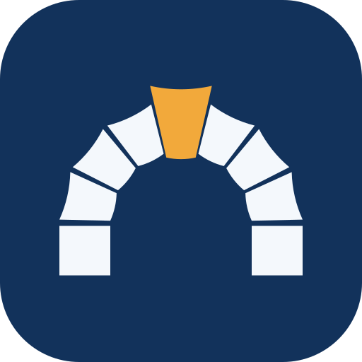

<p align="center">
  
</p>

<h1 align="center">Arrchitect</h1>

<p align="center"><strong>The keystone of your arr stack.</strong></p>

<p align="center">
  <a href="https://github.com/kyleseneker/arrchitect/actions/workflows/ci.yml"></a>
  <a href="https://github.com/kyleseneker/arrchitect/releases"></a>
  <a href="https://artifacthub.io/packages/helm/arrchitect/arrchitect"></a>
</p>

Configure and wire Sonarr, Radarr, Prowlarr, Jellyfin, Plex and other
self-hosted media apps as Kubernetes resources. Arrchitect configures the apps
you already deploy, however you deploy them, and connects them to each other;
it doesn't deploy them.

Arrchitect is alpha: the API is `v1alpha1`, and a minor release can change it.
See [stability and support](docs/stability.md) for what each release promises.

## What it looks like

Each app gets a resource, and one app reaches another by naming its resource
with `appRef`. Here Sonarr gets a root folder and qBittorrent as its download
client, and Prowlarr syncs its indexers to Sonarr, without either connection
repeating an address or an API key:

```yaml
apiVersion: arrchitect.dev/v1alpha1
kind: Sonarr
metadata:
  name: sonarr
spec:
  connection:
    url: http://sonarr.media.svc.cluster.local:8989
    apiKeySecretRef: {name: sonarr-credentials, key: api-key}
  rootFolders:
    - path: /data/media/tv
---
apiVersion: arrchitect.dev/v1alpha1
kind: SonarrDownloadClient
metadata:
  name: sonarr-qbittorrent
spec:
  sonarrRef:
    name: sonarr
  name: qBittorrent
  appRef:
    kind: QBittorrent
    name: qbittorrent
  category: tv
---
apiVersion: arrchitect.dev/v1alpha1
kind: Prowlarr
metadata:
  name: prowlarr
spec:
  connection:
    url: http://prowlarr.media.svc.cluster.local:9696
    apiKeySecretRef: {name: prowlarr-credentials, key: api-key}
  applications:
    - name: Sonarr
      appRef:
        kind: Sonarr
        name: sonarr
```

Arrchitect reads the `QBittorrent` and `Sonarr` resources' connections on every
reconcile, so an address or a key changes in one place.
[examples/jellyfin-stack.yaml](examples/jellyfin-stack.yaml) wires a whole
stack, and [connecting apps](docs/guide.md#connecting-apps) lists every
connection that takes an `appRef`.

## Features

- Settings, download clients, indexers, quality profiles, notifications and other app configuration as YAML
- Drift correction on every reconcile, or an observe mode that only reports differences
- Credentials read from Kubernetes Secrets
- Optional pruning, limited to what the operator created
- `arrchitect export` to generate config from an app you already run
- Tested in CI against each app running in a container, at both ends of its supported range

## Supported apps

Each app is supported at every release from the oldest to the newest in its
range, and every Arrchitect release is tested against both ends. A range
covers the releases of the last 12 months; see the
[stability policy](docs/stability.md#apps) for how it moves and the
exceptions.

| App | Resource | Supported versions |
| --- | --- | --- |
| Sonarr | `Sonarr`, `SonarrIndexer`, `SonarrDownloadClient` | 4.0.16 to 4.0.20 |
| Radarr | `Radarr`, `RadarrIndexer`, `RadarrDownloadClient` | 6.0.4 to 7.0.3 |
| Lidarr | `Lidarr`, `LidarrIndexer`, `LidarrDownloadClient` | 3.1.0 to 3.1.6 |
| Readarr | `Readarr`, `ReadarrIndexer`, `ReadarrDownloadClient` | 0.4.17 to 0.4.18 |
| Prowlarr | `Prowlarr` | 2.3.0 to 3.0.2 |
| FlareSolverr | `FlareSolverr` | 3.4.5 to 3.5.2 |
| Bazarr | `Bazarr` | 1.5.3 to 1.6.2 |
| qBittorrent | `QBittorrent` | 5.1.4 to 5.3.0 |
| SABnzbd | `Sabnzbd` | 4.5.5 to 5.1.3 |
| Jellyfin | `Jellyfin` | 10.11.3 to 12.4 |
| Plex | `Plex` | 1.42.2 to 1.43.5 |
| Seerr | `Seerr` | 3.5.0 to 3.5.2 |
| Maintainerr | `Maintainerr` | 3.30.0 to 3.33.0 |
| Tdarr | `Tdarr` | 3.00.00 to 3.08.00 |
| Autobrr | `Autobrr` | 1.69.0 to 1.91.1 |

## Getting started

Install the chart. It runs every app's controller unless you turn some off in
`apps`:

```bash
helm install arrchitect oci://ghcr.io/kyleseneker/charts/arrchitect \
  --namespace media --create-namespace \
  --set apps.plex=false --set apps.autobrr=false
```

Then apply a config. [examples/minimal-sonarr.yaml](examples/minimal-sonarr.yaml)
adds a root folder to Sonarr:

```bash
kubectl apply -f examples/minimal-sonarr.yaml
kubectl get sonarr -n media
```

To start from an existing setup instead, see
[Exporting an existing app](docs/export.md).

## Documentation

- [User guide](docs/guide.md)
- [Example stack](docs/example-stack.md)
- [Sharing apps with other tools](docs/other-tools.md) such as Recyclarr and Prowlarr
- [API reference](docs/api.md)
- [Stability and support](docs/stability.md)
- [Exporting an existing app](docs/export.md)
- [Rebuilding apps](docs/rebuilding.md)
- [Examples](examples/) and [one sample per resource](config/samples/)

## Contributing

See [CONTRIBUTING.md](CONTRIBUTING.md). Everyone taking part follows the
[code of conduct](CODE_OF_CONDUCT.md). Report security issues as described in
[SECURITY.md](SECURITY.md).

## License

[Apache 2.0](LICENSE)
